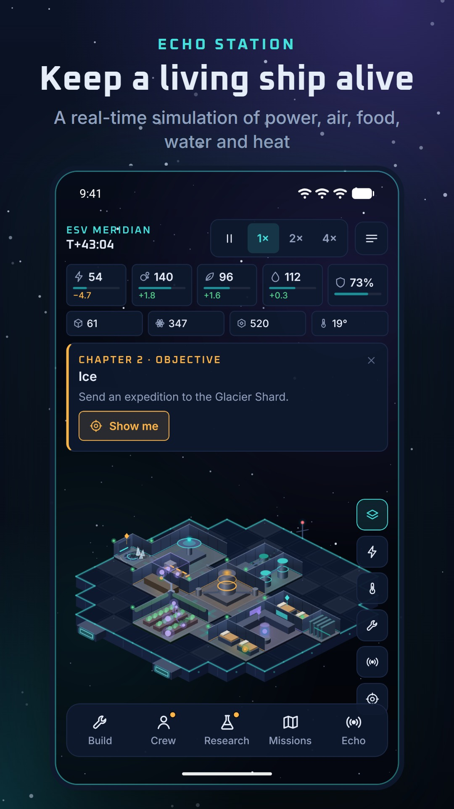
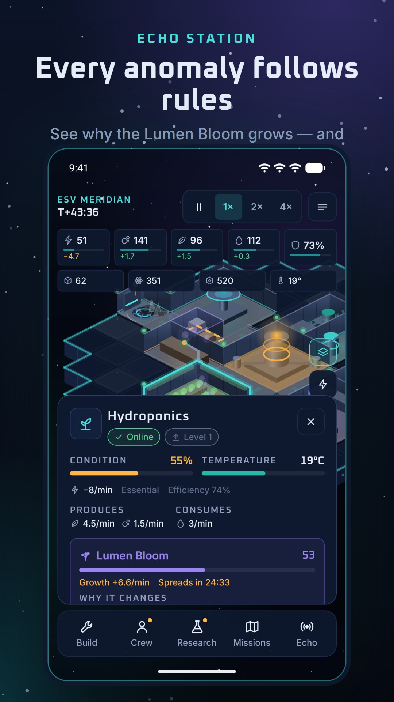
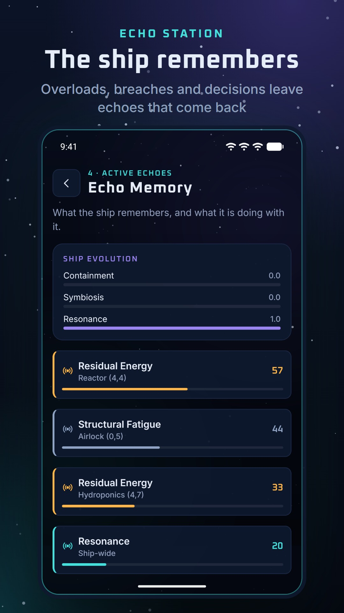
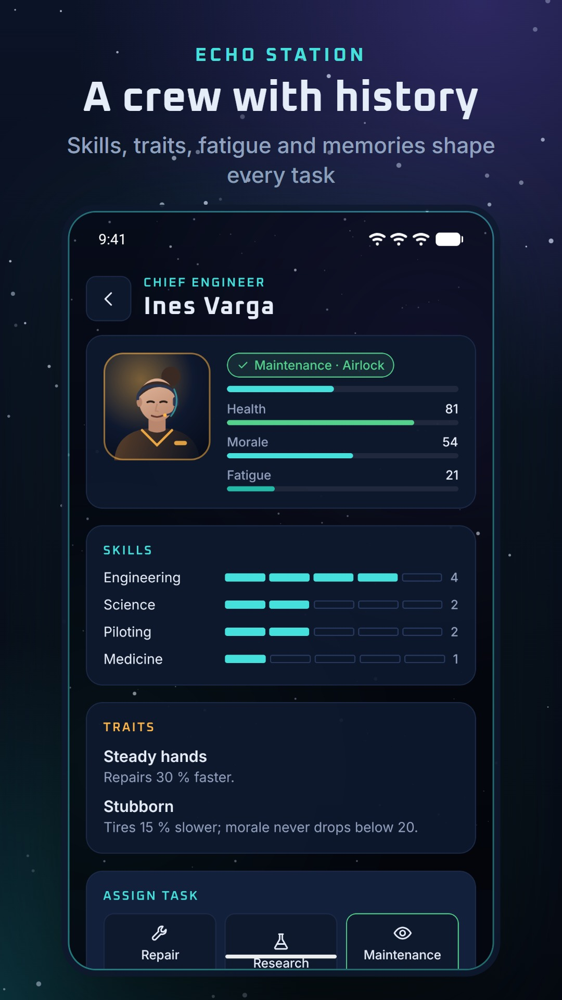

# ECHO STATION — The Living Ship

A sci-fi spaceship management simulation for Android and iOS. You are the caretaker of the ESV Meridian, a damaged research vessel drifting through uncharted space. Repair it, keep the crew alive, contain (or harness) the anomalies spreading through it, explore, and find out what happened to the original expedition.

The signature mechanic is **Echo Memory**: the ship remembers. Reactor overloads leave residual energy in nearby rooms, dead organisms leave contamination, repeatedly damaged rooms develop structural fatigue, and major decisions leave resonance. Echoes stay in the cells where they happened and change the simulation.

Made by **Medin Turkes**.

**Website:** https://metur100.github.io/Echo.Station.Website/ · [privacy policy](https://metur100.github.io/Echo.Station.Website/privacy.html) · [support](https://github.com/metur100/Echo.Station.Game/issues)

<p>
  
  
  
  
</p>

## Features

- **Isometric 2.5D ship** rendered with React Native Skia: pan, pinch zoom, tap to inspect, long press to focus, drag-to-place construction with live validity preview, rotation, power / heat / damage / echo overlays.
- **14 modules:** reactor, oxygen generator, water recycler, hydroponics, crew quarters, storage, laboratory, repair workshop, airlock, corridor, thermal radiator, shield generator, containment field, echo condenser. Data-driven (`src/game/content/modules.ts`), three upgrade levels.
- **Simulation:** priority-based power with a battery and reserve hysteresis, oxygen / food / water life support, heat transfer between rooms, overheating and cold, wear, breaches and decompression, hull integrity.
- **Crew** of three (plus a survivor you can rescue) with skills, traits, health, morale, fatigue, personal history and memories; tasks: repair, research, maintenance, expedition prep, emergency response.
- **Three anomalies** — Lumen Bloom, Static Choir, Void Frost — with explainable growth and deterministic spread; quarantine, purge, emergency response, containment fields, or harness them with research.
- **Research:** 18 projects in four branches (Engineering, Xenobiology, Navigation, Echo Studies) that change gameplay.
- **Expeditions** to four destinations with costs, preparation, risk, crew and rewards; each introduces different constraints or anomalies.
- **Incidents:** 11 data-driven event types with triggers, cooldowns, choices and safe defaults.
- **Campaign** of 14 objectives in four chapters with three endings shaped by your ship's evolution (containment, symbiosis, resonance); captain levels and 15 achievements.
- **Saves:** three slots, autosave, versioned schema with migrations, atomic writes with backup, corruption recovery; bounded offline progression with a summary.
- **Offline-first and private:** no account, no network, no ads, no purchases, no analytics transmission.
- Accessibility: labels on controls, status always as icon + word + colour, 44 dp touch targets, reduced motion (OS and in-game), larger text option. All strings in `src/i18n/en.ts`, ready for more languages.

How the systems work, with all the numbers: [docs/SIMULATION.md](docs/SIMULATION.md). Code structure: [docs/ARCHITECTURE.md](docs/ARCHITECTURE.md). Art and audio sources: [docs/ASSETS.md](docs/ASSETS.md). Current state: [PROJECT_STATUS.md](PROJECT_STATUS.md).

## Tech stack

| | |
|---|---|
| Framework | Expo SDK 57, React Native 0.86, React 19.2, TypeScript (strict) |
| Navigation | Expo Router (`src/app`) |
| Rendering | `@shopify/react-native-skia` 2.6 (ship, overlays, starfield), `react-native-svg` (icons, portraits) |
| Input and animation | `react-native-gesture-handler`, `react-native-reanimated` 4 |
| State | Zustand; the simulation itself is plain TypeScript in `src/game` |
| Persistence | `expo-file-system` JSON files |
| Feedback | `expo-audio` (synthesised sounds), `expo-haptics` |
| Tests | Jest (`jest-expo`), React Native Testing Library, fast-check |
| Builds | EAS Build |

## Requirements

- Node.js 20+ (developed with Node 22.16, npm 10.9)
- Android: an emulator from Android Studio, or a phone with **Expo Go** for SDK 57
- iOS: a Mac with the iOS Simulator, or an iPhone with Expo Go

## Getting started

```bash
git clone https://github.com/metur100/Echo.Station.Game.git
cd Echo.Station.Game
npm install
npm start            # press a for Android, i for iOS, or scan the QR code with Expo Go
```

`.npmrc` sets `legacy-peer-deps=true` because a test-only package declares an older peer range; it does not affect the app.

## Scripts

```bash
npm run typecheck      # tsc --noEmit (strict)
npm run lint           # expo lint
npm test               # Jest: unit, component and campaign playthrough tests
npm run verify         # all three
npm run bundle:check   # production JS bundle export for Android
npm run sounds         # regenerate assets/sounds from scripts/generate-sounds.mjs
npm run icons          # regenerate icon and splash PNGs from scripts/icon-art.mjs (needs Edge or Chrome)
```

Developer tools: `npx tsx scripts/diag-campaign.ts [seed]` plays the campaign bot and prints where it ends; `npx tsx scripts/probe.ts` is a balance probe of the opening minutes.

## Tests

- `tests/unit` — resources, power allocation, temperature, placement, dismantling, upgrades, research prerequisites, crew tasks, anomaly growth / spread / containment, Echo Memory, incidents, expeditions, saves (round trip, backup, corruption, migration, newer schema, concurrency), offline progression, determinism, property-based invariants, isometric math and camera, string completeness.
- `tests/unit/campaign.test.ts` — a bot plays new games through the command API until an ending (guards against soft-locks and pacing regressions).
- `tests/components` — main menu, settings, incident dialog, module inspector, resource bar.

## Releases

- Android / Google Play: [release/android/README.md](release/android/README.md) (AAB via `eas build -p android --profile production`, upload-key handling, verification)
- iOS / App Store: [release/ios/README.md](release/ios/README.md)
- Store texts, privacy answers, screenshot plan and checklist: [release/store-metadata](release/store-metadata)
- Store graphics and screenshots: [release/store-assets](release/store-assets)

App identifiers: `com.certidevelopment.echostation` (Android package and iOS bundle ID). Signing keys and credentials are never committed (`.gitignore`, `.easignore`).

## License

© 2026 Medin Turkes. All rights reserved. Fonts: Oxanium and Inter (SIL Open Font License 1.1).
